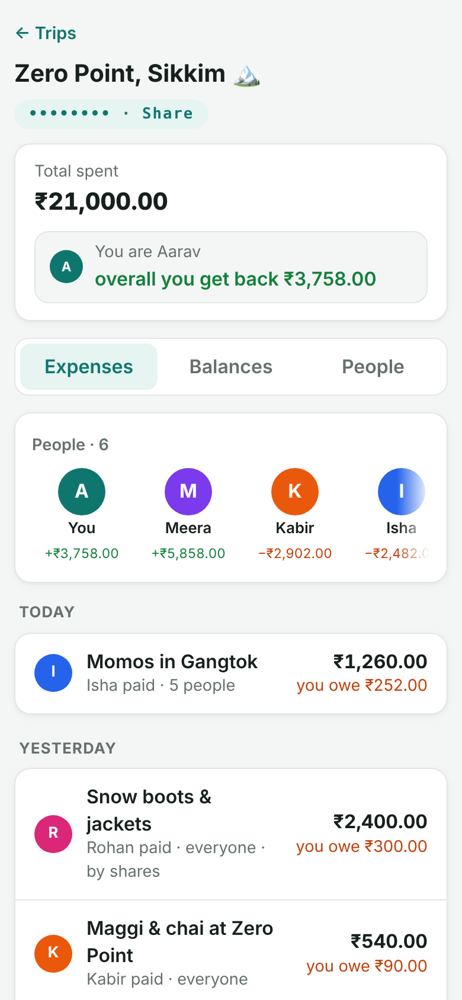
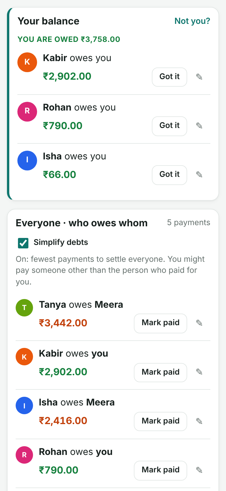
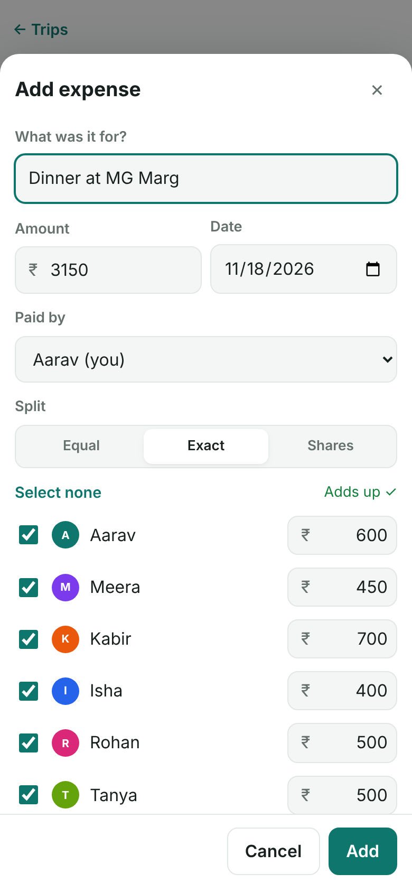

# Splitbox

**Split trip expenses with friends. Free, no sign-up — just share the link.**

👉 **Use it:** https://splitbox.web.app

Built on a trip to Zero Point, Sikkim, from a phone, with [Claude Code](https://claude.com/claude-code) running in the cloud, after the
"who pays whom" feature of the splitter we used went paid.

<p align="center">
  
  
  
</p>

## Features

- Create a trip and share its link (or 8-character code) with your group. No accounts.
- Everyone picks who they are on their own phone (remembered on that device).
- Add expenses: who paid, who was involved, and split **equally**, by **exact amounts** or by **shares**.
- **Who pays whom**: your balance, everyone's debts and a per-person breakdown. Tap **Mark paid** when someone settles up.
- **Simplify debts** (on by default): the fewest payments to settle everyone, or switch it off to repay exactly who paid for you.
- Real-time sync between phones, works offline, installable as an app (PWA), dark mode.

Money is stored in whole paise/cents and split with largest-remainder rounding, so splits always add up exactly.

## Tech

React + Vite, Cloud Firestore, Firebase Hosting. Frontend only: there is no backend server.

| Path | What |
| --- | --- |
| `src/logic.js` | Money logic: parsing, splits, balances, settlements (unit-tested in `logic.test.js`) |
| `src/api.js` | Firestore reads/writes (`trips/{code}` and `trips/{code}/entries`) |
| `src/components/` | React UI |
| `firestore.rules` | Database security rules |

## Run it locally (no Firebase account needed)

```bash
npm install
npx firebase emulators:start --only firestore --project demo-splitter   # terminal 1
echo "VITE_USE_EMULATOR=true" > .env.local && npm run dev               # terminal 2
npm test                                                                # unit tests
```

## Host your own copy

1. Create a Firebase project, enable **Firestore**, and add a **Web app**.
2. Put your web config in `.env` (see `.env.example`). It overrides the defaults in `src/firebase.js`.
3. Set your project id in `.firebaserc` and your site name in its `targets` section.
4. `npx firebase login && npm run deploy`. This builds, checks the build isn't pointing at the emulator, and deploys hosting and rules.

## Security model

There is no login, so the trip code acts as the key: 8 random characters (~10¹² combinations).
`firestore.rules` lets anyone open a trip by its exact code but never list trips, so codes can't be discovered, and
it validates the shape of every write. Anyone with a trip's link can view and edit that trip, so only share it with your group.

The Firebase web config in `src/firebase.js` is public by design (it ships to every browser). Access to data is
controlled by the security rules, not by keeping that config secret.
